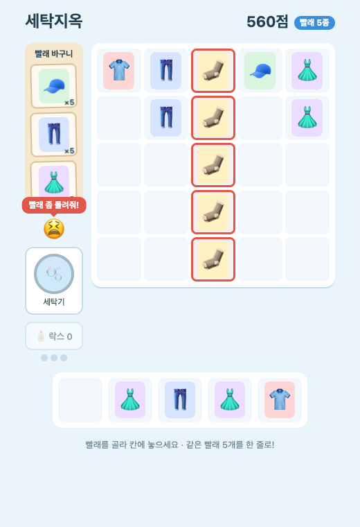

# 세탁지옥

옛 플래시게임 "세탁지옥" 리메이크. 5×5 빨래 빙고.

 

## 규칙

- 하단 빨래 5개를 판에 배치 → 다 놓으면 새 5개
- 같은 빨래 5개 한 줄(가로·세로·대각) → 바구니로 이동 (최대 3개)
- 바구니 빨래를 세탁기에 넣으면 점수 + 락스 재료
- 락스: 판의 칸 1개 지우기
- 판이 꽉 차면 패배

## 실행

```sh
pnpm install
pnpm dev
```
